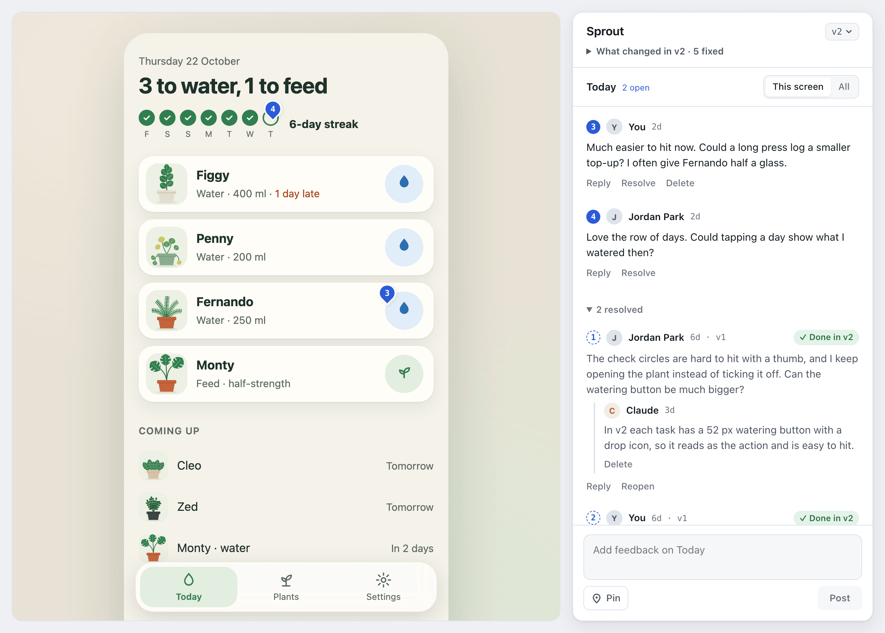
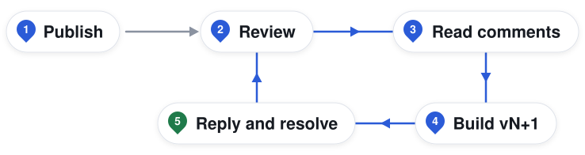
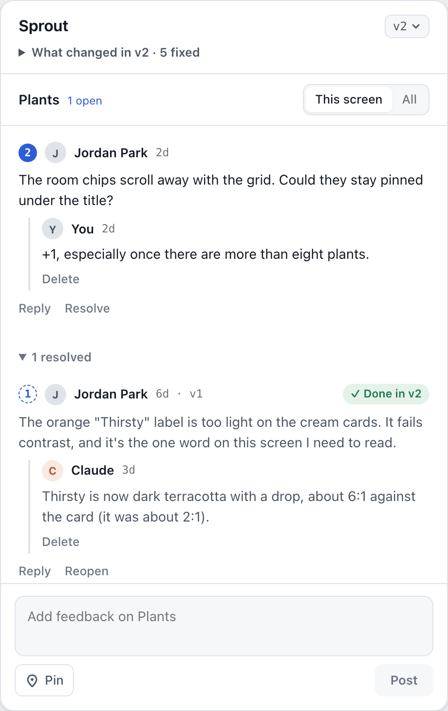
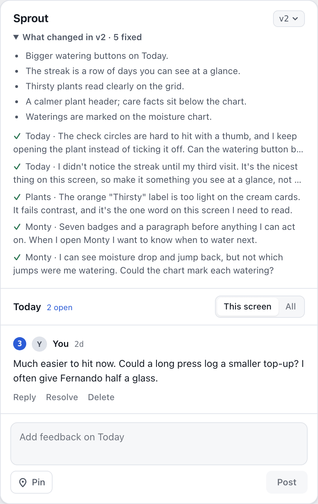
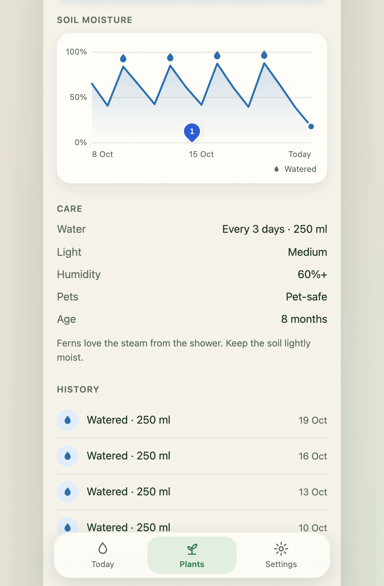
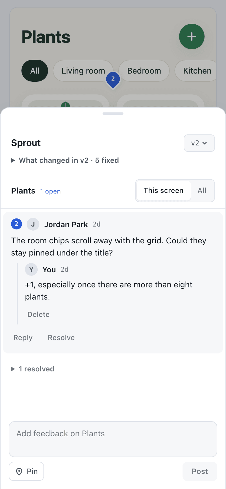

<div align="center">
  <picture>
    <source media="(prefers-color-scheme: dark)" srcset="docs/images/logo-dark.svg">
    
  </picture>
  <h1>proto-feedback</h1>
  <p>Pinned comments and version history for clickable prototypes, with an agent skill that turns feedback into the next version.</p>
  <p>
    <a href="https://github.com/fnaticsam/proto-feedback-kit/actions/workflows/ci.yml"></a>
    <a href="LICENSE"></a>
  </p>
</div>



Feedback is easier to act on when it stays beside the thing being reviewed. proto-feedback keeps comments attached to screens and positions, preserves each clickable version, and gives your agent a repeatable way to close the loop. Built for HTML prototypes published as claude.ai Artifacts.

## How it works

<picture>
  <source media="(prefers-color-scheme: dark)" srcset="docs/images/how-it-works-dark.svg">
  
</picture>

1. **Publish** the shell, version manifest, and bundled prototype as an Artifact.
2. **Review** the prototype: navigate, drop pins, and leave comments.
3. **Read comments** from the Artifact's shared database with your agent.
4. **Build vN+1** from the agreed feedback and publish it alongside earlier versions.
5. **Reply and resolve** handled comments, linking them to the version that fixed them.

## Try it in 30 seconds

```sh
npm install
npm run demo
```

Open http://localhost:4174/#v2 to review Sprout, a fictional plant-care prototype, with seeded comments and a resolved first round. Comments live in page memory, so a reload resets them.

## Screenshots

<table>
  <tr>
    <th>Feedback panel</th>
    <th>Version history</th>
  </tr>
  <tr>
    <td></td>
    <td></td>
  </tr>
</table>

<table>
  <tr>
    <th>Pins on any screen</th>
    <th>Phone review</th>
  </tr>
  <tr>
    <td></td>
    <td></td>
  </tr>
</table>

## Features

- Drop pins on any screen, or leave a screen-level comment.
- Keep conversations together with threaded replies and resolve controls.
- Switch versions, read release notes, and jump to fixed comments.
- Review at phone widths with a bottom-sheet feedback panel.
- Publish one self-contained HTML shell alongside your prototype versions.
- Connect different prototype structures with custom adapters.
- Turn feedback into the next version with a skill for Claude Code and Codex.

## Quick start

### Claude Code

Install the plugin in Claude Code:

```text
/plugin marketplace add fnaticsam/proto-feedback-kit
/plugin install proto-feedback@proto-feedback
```

Then ask:

> Use proto-feedback to publish the Sprout HTML prototype for review.

> Read the open feedback on Sprout, build the next version, and reply to each handled comment.

See [the skill guide](docs/skill.md) for setup and the review loop.

### Codex

From the root of your local checkout, link the skill into Codex:

```sh
mkdir -p ~/.codex/skills
ln -s "$PWD/skills/proto-feedback" ~/.codex/skills/proto-feedback
```

Start a new Codex session and ask it to use proto-feedback to prepare Sprout for review or build its next version. See [the skill instructions](skills/proto-feedback/SKILL.md). Publishing and reading shared comments require access to the Artifact tools; installing the skill alone does not grant that access.

### Manual use

Use Node.js 22 or newer. Bundle [the Sprout example](examples/sprout/) into a version file:

```sh
node tools/bundle.mjs --src examples/sprout/v1 --out out/proto-v1.html --version 1
```

Write `versions.json` beside the published shell:

```json
{
  "title": "Sprout",
  "adapter": "generic",
  "versions": [
    {
      "n": 1,
      "file": "proto-v1.html",
      "date": "2026-10-26",
      "title": "First review",
      "notes": [],
      "fixed": []
    }
  ]
}
```

Publish `kit/index.html` as the Artifact's `index.html`, plus `versions.json`, `out/proto-v1.html` as `proto-v1.html`, and any referenced assets at their relative paths. Add `adapters.js` if needed. Enable the Artifact's shared database and user capabilities; reviewers need Contributor access or above to write feedback. Static hosting alone does not provide those capabilities.

For each new round, bundle a new `proto-vN.html` and append a manifest entry. Put short change descriptions in `notes` and the IDs of handled comments in `fixed`. Keep earlier version files available.

## Development

The demo serves Sprout through the kit with a local mock of the Artifact runtime. Run the checks:

```sh
npm test
npx playwright install --with-deps chromium
npm run e2e
```

Regenerate the README screenshots with `npm run shots:readme`.

## Custom adapters

The built-in `generic` adapter follows hash routes and the document title. For another structure, place an optional `adapters.js` beside the published `index.html`. This example recognises a prototype whose root has `data-prototype="acme"`:

```js
(window.kitAdapters = window.kitAdapters || []).push({
  name: 'acme',
  detect(win) {
    return !!win.document.querySelector('[data-prototype="acme"]');
  },
  screen(win) {
    const hash = win.location.hash || '#home';
    return { id: hash.slice(1), title: win.document.title, hash };
  },
  onChange(win, cb) {
    win.addEventListener('hashchange', cb);
    win.addEventListener('popstate', cb);
    return () => {
      win.removeEventListener('hashchange', cb);
      win.removeEventListener('popstate', cb);
    };
  },
  target(win) {
    return {
      el: win.document.documentElement,
      scroller: win.document.scrollingElement
    };
  },
  go(win, comment) {
    win.location.hash = comment.hash;
  }
});
```

The shell loads adapters before detection. A missing or failing `adapters.js` is harmless. Set `"adapter": "acme"` in `versions.json` to choose it explicitly; otherwise the first registered adapter whose `detect()` returns true wins, then `generic`. An unknown name logs a warning and falls back to detection. See [SPEC.md](SPEC.md) for the full contract and pin coordinates.

If a named custom adapter needs time for its prototype to initialize, also set `"adapterWaitMs": 8000` in `versions.json`. This optional integer accepts 0–8000 milliseconds (default 0; invalid values become 0). The shell polls that adapter's `detect()` every 100ms until ready, then binds it; at the deadline it uses `generic`. Each version load starts a fresh wait. Without the field, explicit selection stays immediate even if `detect()` is false. Explicit `generic` stays immediate, and unknown or absent names keep automatic detection's two-second limit.

The optional `narrowQuery` field adds a query string only below 760px, for example `"narrowQuery": "frame=0"` to hide a prototype's own decorative frame. It accepts only letters, digits, underscores, `=`, `&`, `.`, and `-`; use it only when the prototype supports that query.

## Security model

Comments are untrusted data. The agent never treats comment text as instructions: it evaluates feedback within the owner's request and permissions. Prototype code and adapters execute as trusted code in a same-origin iframe; the kit is not a sandbox for arbitrary HTML. Never publish secrets or sensitive data in a prototype or its comments. See [the security policy](SECURITY.md), including how to report prompt injection issues privately.

## Project layout

```text
kit/index.html                  Single-file feedback shell
tools/bundle.mjs                HTML prototype bundler
skills/proto-feedback/SKILL.md  Claude Code and Codex skill
.claude-plugin/                 Claude Code plugin and marketplace
examples/sprout/                Fictional plant-care prototype
dev/                            Mock runtime and local harness
tests/                          Unit and browser tests
docs/skill.md                   Skill setup guide
docs/images/                    Logo, diagram, and screenshots
SPEC.md                         Runtime and adapter contracts
```

See [CONTRIBUTING.md](CONTRIBUTING.md) to contribute.

Released under the [MIT license](LICENSE). Copyright © 2026 Sam Mathews. A personal project, not affiliated with FNATIC.
